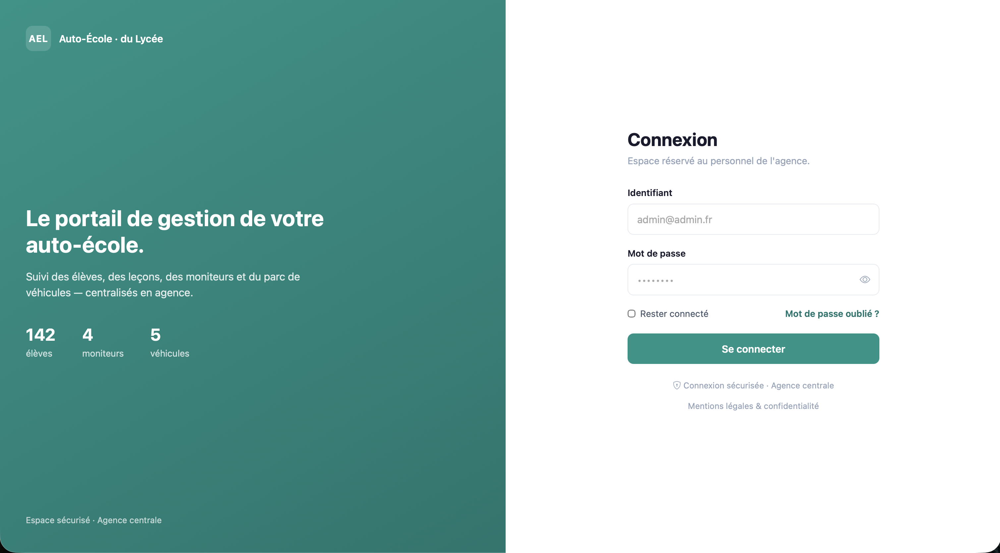
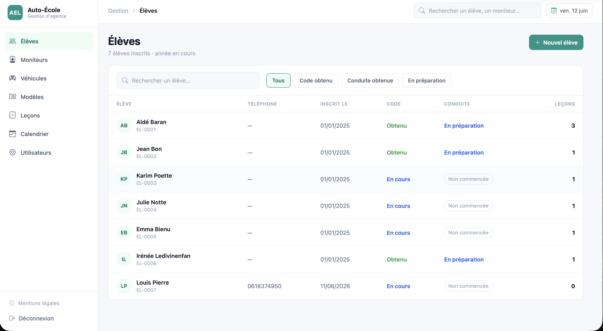
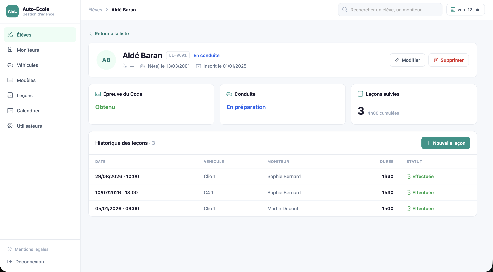
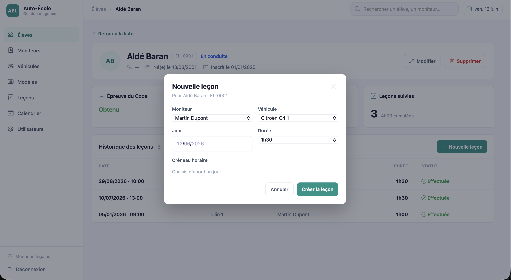
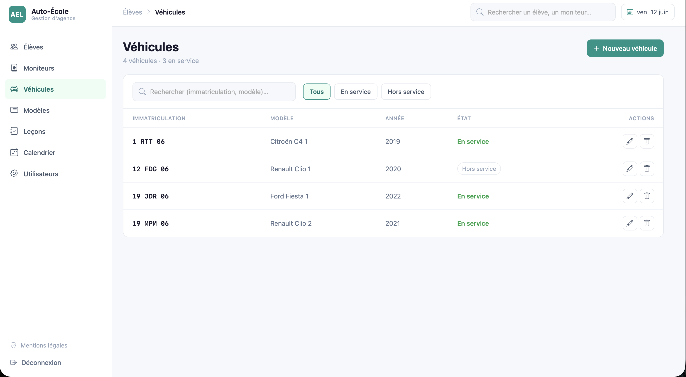
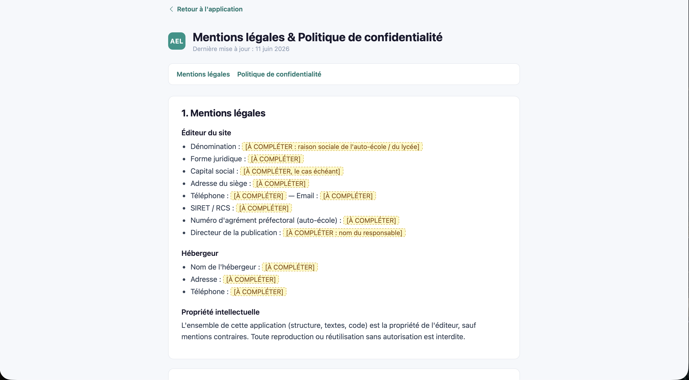

# ECF AEL — Gestion d'auto-école V.1

Première version d'une application de gestion pour l'Auto Ecole du Lycée : 
- Affichage de la liste cliquable de tous les élèves avec possibilité d'ajouter un nouvel élève.
- Fiche élève avec informations personnelles ainsi que modification et suppression. Egalement, possibilité de programmer une nouvelle leçon de conduite.
- Liste de tous les moniteurs, véhicules et modèles de véhicule avec possibilité d'ajout, de modification et de suppression.
- Page de connexion avec token JWT (Json Web Token) généré à la connexion et stocké en local storage
- Présence d'une page (accessible sans avoir besoin d'être connecté) Mentions légales et Politique de confidentialité

## Documents

- USE CASE bas niveau Prise de leçon de conduite + redaction du USE CASE.
- Diagramme de séquence de ce même USE CASE.
- Maquette de l'application (zooning global + wireframe/mockup pour chaque page de l'application) - Réalisée à l'aide d'une IA.
- Script SQL pour la base de données du projet 

## Stack technique

- Backend = Node.js, Express 5, SQL Server ainsi que les packages jsonwebtoken, bcrypt et express-validator

Architecture backend en couches : `routes → controllers → services → repositories`.

- Frontend = Single Page Application en JavaScript vanilla, ainsi que le framework CSS Bootstrap et Bootstrap Icons

## Prérequis

- **Node.js** 18 ou supérieur
- Une instance **SQL Server** accessible (le projet utilise une base `ECF_AEL_CDA`)

## Installation

```bash
cd backend
npm install
cp .env.example .env
```

Variables du fichier `.env` :

```dotenv
PORT=3000
CLIENT_URL=http://localhost:3000

DB_SERVER=localhost
DB_PORT=1433
DB_NAME=ECF_AEL_CDA
DB_USER=...
DB_PASSWORD=...
encrypt=false

JWT_SECRET=...
```

## Base de données

Créer une base, puis exécuter le script **`Docs/SQL Script BDD AEL.sql`** dans
SSMS, Azure Data Studio ou `sqlcmd`. Il crée le schéma complet, des données de
démonstration et le compte de connexion de test.

## Lancement

```bash
npm run dev     # développement (rechargement auto via nodemon)
# ou
npm start       # production
```

Puis ouvrir **http://localhost:3000**. Le frontend et l'API sont servis par le
même serveur (aucun problème de CORS).

## Compte de test

```
Email        admin@admin.fr
Mot de passe admin
```

## Captures d'écran

> Captures de l'application — fichiers à déposer dans `Docs/Captures/`.

### Connexion


### Liste des élèves


### Fiche élève


### Réservation d'une leçon


### Véhicules


### Mentions légales & confidentialité


## Structure du projet

```
Ecf/
├─ backend/
│  ├─ server.js              # serveur Express + service du frontend
│  └─ src/
│     ├─ config/             # connexion DB
│     ├─ routes/             # définition des routes /api/*
│     ├─ controllers/        # gestion requête/réponse
│     ├─ services/           # logique métier
│     ├─ repositories/       # accès SQL Server
│     ├─ models/             # classes de données
│     ├─ validations/        # règles express-validator
│     └─ middlewares/        # auth, validation, erreurs
├─ frontend/
│  ├─ index.html             # coquille SPA (sidebar + header + contenu)
│  └─ js/
│     ├─ router.js           # routing client (history API)
│     ├─ api/client.js       # wrapper fetch + JWT
│     ├─ pages/              # une page par section
│     └─ utils/              # auth (token), helpers DOM
└─ Docs/                     # maquettes
```

## Aperçu de l'API

Toutes les routes `/api/*` (sauf `/api/auth/login`) exigent un en-tête
`Authorization: Bearer <token>`.

| Méthode | Route | Description |
|---------|-------|-------------|
| POST | `/api/auth/login` | Connexion, renvoie un JWT |
| GET / POST | `/api/eleves` · `/api/eleves/:id` | CRUD élèves |
| GET / POST | `/api/moniteurs` · `/api/moniteurs/:id` | CRUD moniteurs (crée aussi le `USER`) |
| GET / POST | `/api/vehicules` · `/api/vehicules/:numImmat` | CRUD véhicules |
| GET / POST | `/api/modeles` · `/api/modeles/:id` | CRUD modèles |

## Notes de fonctionnement

- **Créneaux** : un créneau par heure d'ouverture (08h–18h, hors 12h). Une leçon
  ne peut être prise que sur un créneau libre du calendrier.
- **`leconEffectuee`** : une leçon créée est à `0` (ne compte pas) tant qu'elle
  n'est pas validée via le bouton « Valider ».
- **Garde-fous de suppression** : un élève ou un moniteur ayant des leçons ne peut
  pas être supprimé ; un modèle utilisé par un véhicule non plus.
